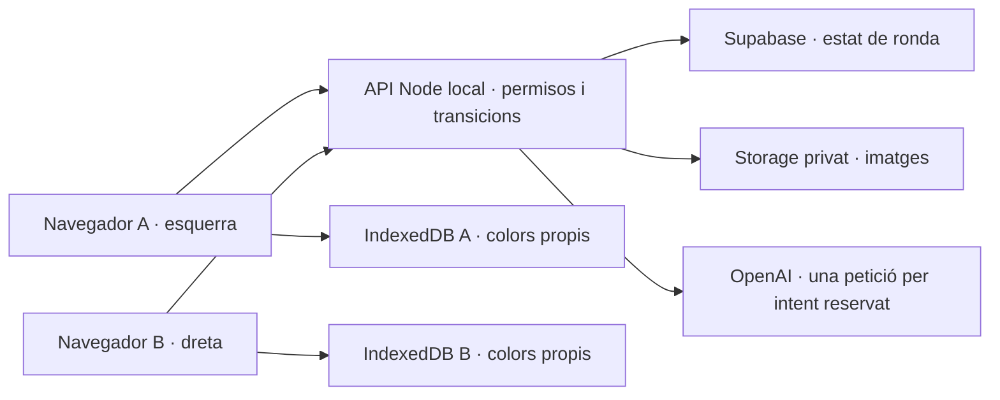

# Half & Half — Pla tècnic

Precisió explícita de l’usuari al primer checkpoint de `5-build`: les dues idees s’han de fusionar en **un sol animal, objecte o ésser híbrid**, amb trets reconeixibles de totes dues. Una escena amb dos personatges separats no satisfà aquest objectiu. Les bases ja generades es conserven; el prompt nou s’aplica a rondes noves.

## How This Works, In Plain Language

React mostra la sala i l’editor al navegador. Un petit servidor Node rep les dues idees, demana **una sola imatge** a OpenAI i guarda la ronda a Supabase. El servidor retalla la imatge: cada navegador rep només el costat que li correspon. Mentre es pinta, els colors es guarden al navegador propi. Quan algú confirma que ha acabat, envia la seva capa de color al servidor; aquest comprova i desa la versió final abans de comptar-la com a acabada. Amb dues versions vàlides i congelades, combina els dos costats i permet veure i descarregar el mateix PNG final.

Per a la demo, React i Node s’executaran al mateix ordinador; Supabase i OpenAI requereixen Internet. Dos perfils de navegador representaran dues sessions independents. Una cookie amb una credencial aleatòria permet reprendre la plaça al mateix navegador, sense compte. Per participar des d’una altra xarxa caldrà una via d’accés al servidor, que no és necessària per gravar la demo local.

**Pla real de `4-spec`, aprovat explícitament el 2026-10-22.** Després de mostrar l’enllaç al pla complet i destacar model, pressupost, cubell i resposta perduda, l’usuari ha respost: «Em sembla tot bé, podem seguir endevant». Aquesta aprovació inclou els detalls proposats en aquesta spec; no són acords anteriors al procés. `4-spec` està completat i l’usuari demana continuar amb `5-build`. En el moment d’aprovar el pla encara no hi havia implementació, infraestructura ni crides de generació. El progrés real posterior és a `checklist.md` i `verification.md`; les comprovacions d’aquesta spec continuen sent criteris i no resultats per si soles.

## The Core Journey Through the System

Implementa `prd.md > The Core Journey`.

1. La home explica l’activitat i ofereix crear sala o introduir el codi. El navegador obté una credencial de sessió abans d’ocupar plaça.
2. El servidor crea una sala i assigna l’esquerra al creador. Una operació atòmica permet ocupar només la plaça dreta amb el codi. Una tercera sessió no hi entra.
3. Cada navegador envia només la seva idea. La confirmació final es fa amb la versió vigent de la sala. Editar retira la confirmació pròpia; si la generació ja ha començat, el servidor rebutja l’edició.
4. Quan hi ha dues idees confirmades, una transacció reserva un intent i pressupost i congela les aportacions. Un únic executor reclama aquell intent i fa la petició a OpenAI. Els navegadors consulten l’estat, sense quedar lligats a la durada de la petició externa.
5. La resposta es desa en privat, es prepara una base en blanc i negre i es retalla exactament. Només quan tots els arxius estan desats es publica l’estat de pintura. Ara es retornen les dues idees originals i la meitat pròpia.
6. El pinzell i el cubell modifiquen una capa de color pròpia. IndexedDB en confirma el desament local; l’estat compartit no transporta traços.
7. «I’m done» confirma la intenció, acaba el desament local pendent i envia una versió final immutable. El servidor valida i desa la capa, després registra la finalització. Si només n’hi ha una, retorna l’espera amb la meitat pròpia.
8. Quan consten dues finalitzacions vàlides, el servidor prepara un PNG amb les dues capes i la base comuna. Fins que aquest PNG no està desat, no anuncia la revelació disponible. Les dues sessions descarreguen els mateixos bytes.



## Stack

Les preferències de React i Supabase provenen de l’usuari. La resta són detalls d’implementació proposats durant `4-spec` i acceptats amb l’aprovació del pla complet. L’aprovació autoritza aquest pla i continuar amb el procés de construcció; no un desplegament.

| Peça | Proposta i motiu | Documentació |
| --- | --- | --- |
| Interfície | React + TypeScript, Vite; una aplicació amb superfícies segons l’estat de la ronda | [React](https://react.dev/learn), [TypeScript](https://www.typescriptlang.org/docs/), [Vite](https://vite.dev/guide/) |
| Servidor | Node 24, Express 5 i TypeScript; serveix la API i, en mode compilat, el frontend | [Node 24](https://nodejs.org/docs/latest-v24.x/api/), [Express](https://expressjs.com/en/guide/routing/) |
| Dades | Supabase PostgreSQL amb funcions transaccionals; `@supabase/supabase-js` només al servidor | [Client](https://supabase.com/docs/reference/javascript/introduction), [funcions](https://supabase.com/docs/guides/database/functions) |
| Imatges | Supabase Storage privat; Sharp al servidor per llegir, normalitzar, retallar i combinar | [Storage](https://supabase.com/docs/guides/storage/buckets/fundamentals), [Sharp](https://sharp.pixelplumbing.com/api-resize/) |
| Pintura | Canvas 2D i Pointer Events; càlcul de regions sobre píxels, sense un editor extern | [Canvas](https://developer.mozilla.org/en-US/docs/Web/API/Canvas_API), [Pointer Events](https://developer.mozilla.org/en-US/docs/Web/API/Pointer_events) |
| Esborrany propi | IndexedDB natiu, amb operacions serialitzades | [IndexedDB](https://developer.mozilla.org/en-US/docs/Web/API/IndexedDB_API/Using_IndexedDB) |
| Imatge amb IA | Images API des del servidor amb `fetch`; petició i resposta explícites per treballar l’objectiu d’aprenentatge | [API](https://developers.openai.com/api/reference/resources/images/methods/generate), [generació](https://developers.openai.com/api/docs/guides/image-generation) |
| Verificació | Tests de domini amb el runner de Node i proves de navegador amb Playwright | [Node test](https://nodejs.org/docs/latest-v24.x/api/test.html), [aïllament de Playwright](https://playwright.dev/docs/browser-contexts) |

Node instal·lat comprovat: `v24.9.0`. Les versions exactes dels paquets s’han de consultar i fixar en instal·lar, amb `package-lock.json` al repositori; no s’ha instal·lat encara cap dependència de l’app. No hi ha Redux, WebSockets, Supabase Auth, Realtime, cua externa ni servei de workers en aquesta proposta. El servidor conserva les regles compartides; React conserva només estat de presentació i pintura pròpia.

## Where It Runs and How Someone Tries It

### Execució local prevista

Implementa `prd.md > Entrada amb codi curt` i `Generació i recuperació de la ronda`.

**Ordres previstes per al build, encara no executables avui:** falten el codi, `package.json`, la configuració i les migracions. El build haurà de crear aquests scripts i comprovar-los abans de presentar-los com a funcionals.

```bash
npm ci
cp .env.example .env
npm run dev
```

Després de preparar la base de dades seguint el futur README de configuració i omplir `.env` localment: obrir `http://localhost:5173` en dos perfils separats. Vite farà de proxy de `/api` cap a Node a `127.0.0.1:3001`, també per a cookies. No alternar `localhost` i `127.0.0.1` al navegador perquè són orígens diferents.

Per gravar amb una sola adreça i el frontend compilat:

```bash
npm run build
npm start
```

Obrir `http://localhost:3001`. Dos perfils normals separats són preferibles a dues pestanyes del mateix perfil, que compartirien identitat. Un context de Playwright separat també aïlla cookies i IndexedDB. El mode privat pot eliminar les dades quan es tanca; no serveix per prometre recuperació posterior al tancament.

### Variables i preparació

Només al servidor: `OPENAI_API_KEY`, `SUPABASE_URL`, `SUPABASE_SECRET_KEY`, `APP_ORIGIN`, `PORT`. La configuració de model i pressupost també queda al servidor. `.env.example` portarà noms i exemples buits, mai secrets; cap clau portarà prefix `VITE_` ni serà al bundle. No demanar les claus al xat. La credencial de participant i les capes de pintura tampoc s’han d’escriure als logs.

Durant la construcció caldrà seleccionar el compte i projecte Supabase correctes; hi ha més d’un compte connectat i no s’ha triat cap projecte. Comprovar la quota abans de crear res. Si no hi ha plaça gratuïta, identificar amb l’usuari quin projecte es pot pausar de manera reversible; no eliminar el de vídeos per suposició. No afegir cap pla de pagament.

### Demo, distància i allotjament opcional

El repositori públic i el vídeo de demostració continuen sent necessaris; el desplegament és opcional segons el pack. Les [regles oficials](https://learn-ai-basics.devpost.com/rules) demanen vídeo públic a YouTube o Vimeo, materials en anglès o traduïts i disponibilitat gratuïta per al jurat fins al final de l’avaluació. La gravació ha de demostrar el recorregut real, inclosa una generació amb les idees de la prova. No publicar claus per facilitar l’accés.

El pla local demostra dues persones i el protocol de sala; no dona per si sol una URL pública a una parella remota. Per provar entre dos ordinadors de la mateixa xarxa caldrà configurar explícitament accés LAN i l’origen; per xarxes diferents caldrà revisar un allotjament gratuït o una altra via d’accés amb HTTPS. Aquesta configuració no forma part del lliurable local obligatori.

Render queda com a preferència futura: un sol Web Service podria servir React compilat i la API, amb dades duradores a Supabase. El seu [pla gratuït](https://render.com/docs/free) pot dormir o reiniciar-se; no s’hi desaran arxius duradors al disc local. Netlify és una alternativa suggerida per l’usuari, encara no seleccionada ni comprovada per a aquesta càrrega. No crear serveis, desplegar ni publicar la candidatura durant `4-spec`.

### Sharing instructions — preparació de `6-ship`

Repositori públic: https://github.com/PolComas/half-and-half, comprovat sense autenticació el 2026-10-23. Codi original sota MIT amb aprovació explícita de l’usuari; claus, perfil d’aprenent i fonts privades excloses. Instruccions tècniques en anglès a [`docs/SETUP.en.md`](../docs/SETUP.en.md), amb execució local i fixture de test diferenciades. Vídeo proporcionat per l’usuari: https://youtu.be/U4B9bVnwe8U. Comprovació sense autenticació el 2026-10-23: oEmbed i pàgina pública retornen HTTP 200; el reproductor indica `OK` i durada de 182 segons (3:02). Es recomana escurçar-lo per sota de tres minuts segons les bases; l’usuari confirma el flux fins a la revelació abans del minut tres i l’enquesta completada. El retall recomanat encara no s’ha confirmat i l’agent no afirma haver visionat el vídeo. No hi ha desplegament. Lliurament confirmat per l’usuari el 2026-10-23 amb rebut de Devpost i enllaç https://devpost.com/software/half-half-62fdrc; la consulta pública de l’agent retorna HTTP 403 i no verifica el contingut publicat. `6-ship` completat. Estat real a [`ship-checklist.md`](ship-checklist.md).

## Look and Feel

Implementa `prd.md > Look and Feel`, `Screens and Layout` i `Prioritat de dispositius`.

Proposta derivada de la direcció aprovada: fons paper `#FAF7F0`, tinta `#25231F`, accent terracota `#B85C44`; tipografia serif de sistema per als titulars i sans de sistema per a controls. Sense dependència de fonts remotes. Espai generós, pocs elements i il·lustració com a protagonista. La home tindrà marca, explicació breu, crear sala i entrar per codi; no mostrar controls de comptes o configuració sense funcionalitat acordada.

L’editor tindrà la meitat pròpia centrada, idees visibles quan correspongui i eines agrupades. En pantalla estreta, eines sota el llenç; no reduir les coordenades del dibuix, només l’escala visual. Controls tàctils d’almenys 44 píxels CSS, noms accessibles, focus visible i confirmacions operables amb teclat. `touch-action: none` només sobre el llenç, per poder desplaçar la resta de la pàgina. Respectar reducció de moviment a tota l’app.

Segona revisió de fons del 2026-10-23: més figures SVG, trajectes CSS lineals amb rotació lenta, durades i fases fixes, reinici només fora del viewport. Setze figures a escriptori i deu en mòbil, sense timers ni llibreries noves. `aria-hidden` i `pointer-events: none`; control a la capçalera sticky, preferència local quan Storage ho permet i reducció de moviment del sistema com a valor inicial. Després del feedback de bloqueig, una elecció explícita permet activar o pausar només el fons encara que el sistema demani reducció; les animacions de contingut continuen reduïdes. El desplaçament reserva espai per a la capçalera. Pausar conserva posició, rotació i temps de la mateixa animació; reprendre continua des d’aquell punt, també amb moviment reduït. No substituir la pausa per una altra composició estàtica. Les proves de layout/toc emulat no acrediten suport complet de Safari o de dispositius físics. El canvas de pintura encara no ofereix una alternativa amb teclat per omplir regions: no es declara conformitat WCAG.

Refinament visual demanat al primer checkpoint: paper càlid amb línies de llapis i formes orgàniques terracota als marges, amb deriva molt lenta. Jerarquia: il·lustració principal, instrucció breu i acció; editor amb llenç dominant i eines al costat (sota en mòbil). Interacció: entrada suau existent, deriva ambiental de dues formes i resposta clara dels controls. Decoració sense interacció ni contingut, sense tapar text o llenç i estàtica amb `prefers-reduced-motion`.

UI íntegrament en anglès. No afegir una previsualització completa, ni tan sols com a transició o miniatura. La il·lustració de la home, si s’explora durant el build, serà un asset d’exemple clarament diferenciat; no provocar una crida en obrir la pàgina. Qualsevol crida d’OpenAI per a aquest asset també consumirà el pressupost global; si no s’utilitza OpenAI caldrà indicar l’eina real. No hi ha asset generat encara.

Refinament visual posterior (2026-10-23): l’usuari demana aparença professional, elements amb propòsit, moviment de fons suau com MazeMind i més profunditat. S’ha consultat el component de referència al seu projecte local: partícules connectades i moviment lent. Concreció d’implementació: conservar identitat paper/tinta/terracota, afegir una xarxa SVG pròpia amb camps de color subtils i una composició editorial més clara; il·lustració híbrida d’exemple ja generada durant les proves, sense cap nova crida de pagament. Hero amb imatge dominant i acció única de crear/reprendre; entrar per codi i historial local en regions diferenciades. Entrada suau, xarxa de fons lenta i resposta de botons; moviment reduït estàtic, sense interferir amb el llenç.

## Components

### Home, sala i identitat sense registre

Implementa `prd.md > Entrada amb codi curt` i `Generació i recuperació de la ronda`.

Cookie amb token aleatori de 32 bytes; només se’n desa el hash SHA-256 a la base de dades. `HttpOnly`, `SameSite=Lax`, `Path=/`, durada proposada de 14 dies; `Secure` amb HTTPS. L’excepció de desenvolupament és el servidor local HTTP. El servidor determina el participant a partir de la cookie: no accepta del cos de la petició un costat o participant que substitueixi aquesta identitat. Comprovar `Origin` en mutacions i acceptar únicament l’origen configurat.

El codi proposat és de 6 caràcters majúsculs sense caràcters ambigus, generat aleatòriament i amb índex únic. Acceptar minúscules normalitzant-les. Només permet ocupar la plaça dreta si és lliure; mai recuperar una plaça ocupada ni obtenir-ne dades. Caducitat d’entrada proposada: 24 hores si falta la segona persona. La ronda i la credencial es poden reprendre durant 14 dies. No reciclar codis durant la retenció. Una sala amb dues places rebutja altres sessions encara que hagin esborrat les cookies.

La creació i unió són atòmiques i idempotents amb un identificador d’operació del navegador. Crear o entrar amb una sessió ja associada retorna la plaça existent. No implementar transferència de plaça, recuperació després d’esborrar dades o diverses rondes dins d’una mateixa sala. Si la identitat s’ha perdut, explicar-ho sense substituir la persona existent.

### Idees, confirmacions i estat compartit

Implementa `prd.md > Escriure i confirmar les idees` i `Dibuix compartit i visibilitat`.

Text propi entre 1 i 300 caràcters després de treure espais als extrems; preservar el contingut original validat, amb salts de línia i caràcters tractats com a text. La confirmació en dos passos és de la idea pròpia. El servidor torna a validar buit, longitud, fase i versió encara que el frontend ja ho faci.

Cada mutació aporta `expectedVersion` i un `operationId`; si s’ha avançat la sala, `409` obliga a recuperar-ne l’estat abans de repetir. Confirmar i editar es resolen sota bloqueig de la fila de sala. Si l’edició es confirma primer, ja no hi ha dues aportacions llestes; si la generació es reserva primer, editar queda rebutjat. El servidor no promet prioritat entre accions simultànies.

Consulta d’estat cada 2 segons mentre s’espera, amb pausa en segon pla i actualització immediata en tornar a la finestra. Les mutacions retornen la nova versió. La resposta conté fase, costat propi, idea pròpia, indicadors de presència/confirmació/finalització i intents disponibles. L’altra idea només s’hi inclou quan la base està disponible. Mai serialitzar files senceres de participants ni rutes privades de Storage.

### Coordinador de generació única

Implementa `prd.md > Generació i recuperació de la ronda`, `Errors de generació i intents limitats` i `Topall global de generació de la demo`.

Una transacció comprova dues confirmacions, reserva comptador de ronda i global, congela les dues idees en un intent i passa la sala a `generating`. Una restricció única parcial evita més d’un intent no resolt per sala. Tots els camins que necessitin pressupost bloquegen primer la fila de pressupost i després la sala, en aquest ordre; no mantenir cap bloqueig durant una crida HTTP o pujada d’arxiu.

Un `claim` atòmic d’`attemptId` autoritza un únic executor a passar de `reserved` a `sending`. Estats d’intent: `reserved`, `sending`, `preparing`, `succeeded`, `failed` i `uncertain`; l’índex d’unicitat considera no resolts els quatre primers estats no terminals (`reserved`, `sending`, `preparing`, `uncertain`). La crida viu al procés Node, independent de la connexió del navegador; la petició de confirmació retorna l’estat sense esperar la imatge. Recarregar, consultar estat, un segon clic o una segona sessió no creen cap petició externa nova. Una reserva encara no reclamada es pot reclamar en recuperar el servei; un intent que ja es va marcar `sending` no es torna a enviar.

En rebre la imatge, desar primer el PNG original amb una clau privada derivada d’`attemptId`; després preparar base i meitats. Publicar `painting` només amb el manifest complet i els hashes verificats. Si falla la preparació o l’actualització de dades, reprocessar l’arxiu desat, sense tornar a OpenAI.

Error definitiu de l’API: registrar un error curt i filtrat, conservar el comptador i habilitar reintent explícit, amb 3 intents totals per ronda. Després d’editar, cal reconfirmar. Les dues sessions comparteixen el mateix intent i límit; no hi ha reintents automàtics del transport HTTP.

**Compromís acceptat en aprovar aquesta spec:** una recàrrega de navegador es recupera; una caiguda de Node, timeout o pèrdua de resposta d’OpenAI pot deixar l’intent en `uncertain`. En arrencar, cercar primer un arxiu ja desat per aquell intent. Si existeix i és vàlid, reprendre la preparació. Si no hi és, no es pot deduir si OpenAI ha acabat o cobrat: conservar reserva i bloquejar reintents de la ronda. No convertir el timeout en un error definitiu ni reenviar una petició a cegues. Missatge: «We couldn’t recover your drawing. This round can’t continue safely.» No prometre recuperació que la API directa no acredita. Canviar aquest compromís exigiria revisar el mecanisme de generació; no fingir una garantia d’execució exactament una vegada del proveïdor.

### Preparació de base i tall exacte

Implementa `prd.md > Dibuix compartit i visibilitat` i `Pintar i corregir`.

Proposta: una base de **1024 × 1024** píxels; dues meitats de **512 × 1024**. Verificar dimensions de la resposta. Rebutjar una mida inesperada abans de publicar-la, sense redimensionar o canviar la base silenciosament. La base es converteix determinísticament a blanc i negre amb un llindar inicial de luminància de 180/255, pendent d’avaluació amb una mostra real. El manifest desa `baseId`, hash, dimensions i versió del preprocessament; després de començar a pintar és immutable.

Retallar al servidor: esquerra `x=[0,512)`, dreta `x=[512,1024)`, totes dues `y=[0,1024)`. Sense columna repetida, espai central, mirall ni segona generació. Servir només la base de la meitat autoritzada. El client pot preparar una capa de contorns a partir d’aquesta meitat, però mai necessita el fitxer complet. Verificar reconstrucció pixel a pixel abans de pintar.

### Editor amb pinzell, cubell i correcció

Implementa `prd.md > Pintar i corregir`.

Tres capes lògiques: blanc de fons, colors editables i contorns negres immutables a sobre. El color no substitueix el dibuix. Coordenades fixes de 512 × 1024; convertir les coordenades del punter segons el rectangle visual i retallar sempre a aquest domini. Una pantalla d’alta densitat no canvia les dimensions de les dades.

Pinzell amb traços rodons interpolats i captura del punter fins a finalitzar o cancel·lar el gest. Proposta de gruix: 2–48 píxels del dibuix, inicial 12. Paleta inicial de 12 colors (`#E45756`, `#F28E2B`, `#EDC948`, `#59A14F`, `#76B7B2`, `#4E79A7`, `#7B61A8`, `#B07AA1`, `#FF9DA7`, `#9C755F`, `#FFFFFF`, `#333333`) i selector visual amb degradat de matís/saturació/lluminositat per a colors RGB sòlids. El control de gruix mostra la mida circular i no afecta el cubell.

Cubell: components connexos de píxels blancs de la **base**, amb quatre veïns, calculats només dins de la meitat pròpia. El marge de la meitat actua com a límit, inclòs el tall central. Un clic sobre contorn no pinta. Omplir assigna el color a tota aquella regió, inclosos colors previs; els traços de pinzell no creen noves regions per al cubell en aquesta proposta. Aquesta concreció s’ha destacat a la revisió i s’ha acceptat amb l’aprovació del pla complet; pot diferir del comportament de Paint.

«Undo» recupera la instantània anterior a l’última acció completada, inclosa la neteja; conservar una acció de desfer en aquesta primera versió. Una nova acció substitueix aquesta instantània. «Clear colors» demana confirmació i deixa transparent només la capa pròpia. Desfer i netejar entren al mateix circuit de desament. No afegir goma, redo, zoom o eines no acordades.

**Investigació primerenca necessària:** provar cubell i pinzell sobre almenys una generació real, incloent contorns amb petites obertures i regions que travessen el centre. El prompt no garanteix regions tancades. Si un buit connecta dues zones, el cubell pot omplir-les juntes; cal demostrar-ho i ajustar prompt o preprocessament abans de continuar. Una retirada del cubell o un canvi de requisit requereixen revisió amb l’usuari.

### Desament automàtic i recuperació pròpia

Implementa `prd.md > Desament automàtic de la pintura pròpia`.

IndexedDB desa capa de colors, instantània de desfer, configuració d’eines i revisió, vinculades a `(roomId, participantId, baseId, side)`. Escriure al final de cada traç, ompliment, desfer i neteja. Durant un traç llarg, un checkpoint com a màxim cada segon limita la finestra pendent; si es recupera, el checkpoint es tracta com l’últim traç recuperat. Serialitzar les escriptures i ignorar resultats vells perquè un desament lent no sobreescrigui una revisió posterior.

Mostrar «Saving…» quan hi ha revisions pendents i «Saved on this device» només després de completar la transacció d’IndexedDB. En error, conservar el llenç en memòria, indicar «We couldn’t save on this device» i oferir reintent. No utilitzar `beforeunload` com a garantia d’escriptura ni prometre que un canvi encara pendent sobreviurà a un tancament sobtat. En recarregar, recuperar primer l’estat de la sala; només restaurar una capa compatible i editable. Si el servidor ja ha confirmat la finalització, preval la còpia final congelada.

Per evitar dues pestanyes del mateix participant escrivint sobre la mateixa pintura, el futur build haurà de permetre un sol editor actiu per origen amb [Web Locks](https://developer.mozilla.org/en-US/docs/Web/API/Web_Locks_API) i notificació entre pestanyes; les altres mostren l’espera d’edició. En adquirir el bloqueig després de tancar l’altre editor, rellegir IndexedDB abans d’habilitar eines. No es consideren dos participants. Aquesta API necessita un context segur; validar `localhost` durant el build i HTTPS si es desplega. Si manca suport, impedir el segon editor amb un mecanisme equivalent verificat abans de donar el desament per complet.

### Desament final vàlid, espera i revelació

Implementa `prd.md > Acabar, esperar i revelar`.

La confirmació d’acabar captura una revisió concreta, atura noves accions mentre s’envia i espera les escriptures locals pendents. Si fallen, no finalitza. Enviar PNG de **la capa de color**, `baseId`, revisió i `commitId` persistent. El servidor calcula el hash, comprova sessió, plaça, fase, base i PNG real de 512 × 1024 amb límit de 8 MiB; no acceptar una imatge arbitrària com a base ni confiar en MIME, costat o hash aportats pel client.

Desar el PNG en un objecte privat immutable. Només després d’una pujada correcta, una transacció registra hash, arxiu i finalització sota bloqueig de sala. No comptar dos commits de la mateixa plaça com a dues persones. Repetir el mateix commit i hash retorna el resultat existent; intentar reutilitzar-ne l’ID amb altres píxels es rebutja. Després d’una resposta perduda, consultar l’estat abans de tornar a enviar. Si no es va registrar, reintentar el mateix commit és segur; un objecte pujat sense registre no revela res.

Amb una sola finalització, continuar servint únicament la meitat pròpia. Amb dues, congelar la parella de referències i preparar el resultat: blanc + colors esquerres a `x=0` + colors drets a `x=512` + contorns de la base comuna. El nom de l’objecte final deriva del manifest i dels dos hashes. Dues preparacions simultànies produeixen el mateix contingut; publicar una sola referència verificable. Un error de composició es pot reintentar sense tocar finalitzacions ni regenerar imatges.

### Descàrrega i protecció de dades

Implementa `prd.md > Descarregar el resultat` i `Dibuix compartit i visibilitat`.

PNG complet de 1024 × 1024 amb `Content-Disposition: attachment`, nom `half-and-half.png`. Disponible només a participants de la sala amb dues finalitzacions vàlides i resultat desat. La vista de revelació i la descàrrega llegeixen el mateix objecte. No galeria pública, publicació automàtica ni URL pública permanent.

Storage privat, sense polítiques per a `anon` o `authenticated` per al bucket del projecte. Les taules exposades tenen RLS habilitat i sense permisos d’aquests rols; funcions `SECURITY INVOKER`, execució revocada a `PUBLIC`, `anon` i `authenticated`, concedida només al rol de servei. Declarar explícitament els permisos de servei necessaris. La clau secreta evita RLS: per això **la comprovació de cada participant a Node és obligatòria**, també quan retorna fitxers. No considerar RLS una comprovació d’identitat que el servidor pugui ometre.

No lliurar l’original complet, la meitat aliena, rutes internes, hashes de credencials ni URL signades de tercers. Els fitxers viatgen pel servidor amb autorització i `Cache-Control: no-store`; no hi ha service worker ni precàrrega del resultat. Rebutjar requests que intentin canviar costat, participant, sala o ruta. El límit de la privacitat és entre participants de l’app; l’operador del servidor i els proveïdors que processen les dades no són destinataris exclosos per aquesta arquitectura.

### Navegació i historial local — iteració del 2026-10-23

Home navegable amb fragment `#home`, mantenint sala i credencial, i acció per reprendre. Després de revelar, `POST /api/rooms/restart` valida l’estat del participant; crea/uneix una sala amb credencial nova i només aleshores canvia la cookie HttpOnly. Derivar la nova credencial amb HMAC de la credencial anterior i `operationId` permet reprendre la mateixa operació si no arriba la resposta. Una entrada fallida no substitueix la sessió. Respostes de polling anteriors al canvi de sessió no sobreescriuen la sala nova; comparar versions només dins de la mateixa sala. No cal canviar l’esquema Supabase.

IndexedDB separat `half-and-half-artworks`: fins a tres resultats, identificats per `baseId`, amb PNG Blob, idees i data. Transacció atòmica conserva tres entrades recents, sense duplicar una base quan es recarrega. Obtenir `/api/room/result` només després de l’autorització de revelació. URLs de Blob locals per miniatures i descàrregues, revocades en desmuntar; no servir aquestes còpies des de l’API ni consultar objectes de sales anteriors. La recuperació de la ronda antiga passa a ser el PNG local/descarregat quan es canvia de sala.

## Data Model

Proposta de quatre taules, una ronda per sala. No hi ha comptes personals ni esquema de galeria.

| Dada | Camps principals i persistència |
| --- | --- |
| `rooms` | UUID, codi únic, `version`, fase, dates d’entrada/caducitat, intent actiu, manifest de base, referència final; a PostgreSQL |
| `participants` | UUID, `room_id`, costat, hash de credencial únic, idea pròpia, confirmació, `commit_id`, hash/ruta/revisió finals, data de finalització; a PostgreSQL |
| `generation_attempts` | UUID, sala, ordinal 1–3, còpia de les dues idees confirmades, model/paràmetres/prompt versionat, estat, executor, dates, arxiu original, ús retornat si existeix, codi d’error filtrat; a PostgreSQL |
| `demo_budget` | Una fila persistent per a aquesta demo: nombre d’intents reservats, màxim, reserva monetària i sostre; no es reinicia amb el procés ni amb sales noves |
| Esborrany de colors | Només a IndexedDB propi fins a acabar; no s’envia amb les consultes d’estat |
| Imatges | Bucket privat: original per intent, base i dues meitats per base, capes finals per commit i PNG revelat per manifest |

Restriccions: unicitat `(room_id, side)` i `(room_id, ordinal)`, FK i índex sobre `participants.room_id` i `generation_attempts.room_id`; finalització només amb referència final i base compatibles. La fila de sala bloquejada serialitza entrada, idees i finalitzacions. El topall global i l’intent es reserven junts en transacció; una reserva incerta no es retorna al pressupost. No crear índexs addicionals sense una consulta que els necessiti.

Fases de sala: `waiting_partner → ideas → generating → painting → composing → revealed`. `generation_failed` permet reintent dins dels límits o edició pròpia; `generation_uncertain` no permet reenviar; `generation_exhausted` i `budget_blocked` expliquen el límit. La quota no canvia una sala que ja està pintant. Durant `painting`, les dues marques de finalització descriuen qui espera sense inventar una fase diferent per persona. Les transicions no les decideix el navegador.

Retenció proposada: accés a ronda durant 14 dies i conservació privada de dades i objectes durant 30 dies, amb neteja manual documentada després del període de jurat. No esborrar automàticament una partida activa o necessària per avaluar. Les dades locals no desapareixen per una neteja del servidor: explicar la caducitat i eliminar-les només amb una acció local explícita o la política local documentada. No es promet còpia de seguretat gestionada del pla gratuït.

## Application API Contracts

Mateix origen del frontend. JSON filtrat, versió monotònica i errors `{ code, message, retryable }`; els textos d’usuari són en anglès. Respostes de mutació perdudes es recuperen llegint l’estat; no repetir generacions per un error del client.

| Crida prevista | Entrada i resultat |
| --- | --- |
| `POST /api/session` | Estableix cookie si falta; si existeix no rota la credencial ni perd la plaça |
| `POST /api/rooms` | `{ operationId }` amb cookie; crea o retorna sala pròpia i costat esquerre |
| `POST /api/rooms/join` | `{ code, operationId }`; ocupa atòmicament dreta lliure o rebutja |
| `GET /api/room` | Sala associada a la cookie, fase, versió i dades autoritzades; sense token en URL |
| `PUT /api/room/idea` | `{ text, expectedVersion, operationId }`; desa idea pròpia no confirmada |
| `POST /api/room/idea/confirm` | Versió i operació; confirma i pot reservar automàticament l’únic intent |
| `POST /api/room/idea/edit` | Retira només confirmació pròpia si la fase ho permet |
| `POST /api/room/generation/retry` | Versió i operació; només després d’error definitiu, amb dues confirmacions i quota |
| `GET /api/room/base` | Només PNG de la meitat pròpia, disponible quan la base està publicada |
| `POST /api/room/finish` | PNG de colors al cos (`image/png`, màxim 8 MiB), capçaleres `X-Base-Id`, `X-Revision` i `X-Commit-Id`; confirma només després de desar i validar |
| `GET /api/room/my-final` | Només la capa final pròpia per restaurar la vista tancada |
| `GET /api/room/result` | PNG complet només en `revealed`; abans, denegat sense contingut parcial |
| `GET /api/room/download` | Mateix objecte amb capçalera de descàrrega; mateixa autorització |

Límits inicials proposats al servidor: JSON màxim 16 KiB, PNG 8 MiB, entrada per codi 10 intents/minut/IP i creació de sala 5/minut/IP. Són proteccions d’una demo local, no defensa suficient per obrir-la massivament; no hi ha quota diària personal. Les reserves de generació sempre són persistents encara que els límits de freqüència locals es perdin en reiniciar. La fase de deploy, si s’arriba a fer, revisarà aquests límits.

## External Services and Dependencies

### OpenAI: petició, prompt i resposta

Model acceptat en la revisió: **`gpt-image-2.5-flare-2026-09-08`**, `quality: low`, `size: 1024x1024`, `n: 1`, `output_format: png`, `background: opaque`, `moderation: auto`, sense streaming. La [referència actual](https://developers.openai.com/api/reference/resources/images/methods/generate) enumera aquest snapshot; la [guia](https://developers.openai.com/api/docs/guides/image-generation) inclou Flare per a noves integracions. L’accés d’aquest compte s’ha verificat amb generacions reals durant `5-build`. La base en blanc i negre és pintable amb ambdues eines; s’han observat contorns oberts que poden unir regions del cubell. `verification.md` en registra les proves i el prompt reforçat. No canviar de model automàticament si falla l’accés.

Contracte: `POST https://api.openai.com/v1/images/generations`, `Authorization: Bearer OPENAI_API_KEY`, JSON amb els paràmetres anteriors i `prompt`. `fetch` de Node sense reintents automàtics; timeout de 5 minuts com a límit local d’espera, no com a prova que el proveïdor ha aturat el treball. Validar que hi ha exactament una imatge decodificable a `data[0].b64_json`; registrar `usage` si la resposta el proporciona. No retornar la resposta crua o el base64 complet al navegador ni als logs.

El prompt versionat combinarà les dues idees, amb text total màxim de 2.000 caràcters. Regles de proposta: un únic subjecte híbrid que fusioni físicament trets de totes dues aportacions, sense dos subjectes separats; llibre per pintar amb línia negra sobre blanc, contorns clars i zones grans tancades, sense ombres ni grisos, text, marcs o divisió dibuixada; elements amb interès als dos costats. Tractar les aportacions com a contingut creatiu, no com a instruccions que anul·lin el format. Si una no és interpretable, inventar un objecte estrany que es combini amb l’altra. Conservar les idees originals per mostrar-les. No hi ha una crida de text prèvia ni classificador semàntic extra. El prompt i el llindar s’han validat amb mostres reals durant el build. `hybrid-coloring-v3` reforça siluetes tancades i sense traços de pèl interromputs. Es normalitzen caràcters de control només per enviar el prompt, sense substituir les idees originals.

### Pressupost i límits

Implementa `prd.md > Topall global de generació de la demo`.

Límit de l’usuari: 7 USD de crèdits que declara disponibles, cap càrrec addicional. **Topall acceptat en aprovar la spec:** 20 peticions reals com a màxim per a tota la demo, comptant proves d’OpenAI, intents inicials, reintents i assets si s’utilitza aquesta API. Reserva interna de 0,25 USD per intent: 20 × 0,25 = 5 USD planificats, amb 2 USD de marge. Aquesta reserva és una mesura de planificació, **no un preu per imatge ni una garantia de facturació**. Les peticions de test amb un proveïdor simulat no consumeixen crèdit i no serveixen d’evidència de la IA real.

Abans de la primera petició de pagament: comprovar saldo real, accés al model i estimació per la mida, qualitat i prompt fixats al [calculador oficial](https://developers.openai.com/api/docs/guides/image-generation#calculating-costs) i [preus](https://developers.openai.com/api/docs/pricing). Si l’estimació excedeix la reserva, aturar i revisar els paràmetres o el topall, sense gastar per sobre del pressupost aprovat. Després de la primera mostra revisar ús i despesa observats abans de fer-ne més. No executar proves de generació massives.

Complementar amb un límit dur de projecte OpenAI de 5 USD, si es disposa dels permisos necessaris, i verificar que no hi ha recàrrega automàtica que pugui afegir càrrecs. El límit encara **no està configurat**; la [documentació oficial](https://developers.openai.com/api/docs/guides/spend-limits) distingeix alertes de límits durs i adverteix que aquests últims poden aplicar-se amb retard. No afirmar una garantia absoluta de tall exacte a 7 USD. Si no es pot confirmar una configuració de facturació compatible amb no pagar més, no fer la primera crida real fins a resoldre-ho.

El comptador global resideix a Supabase i cap ruta pública el pot reiniciar. No retorna reserves fallides o incertes. Un reinici autoritzat requeriria revisar saldo i límit; no és un botó de l’app. Deixar capacitat per gravar i per a la comprovació del jurat; `6-ship` haurà de revisar disponibilitat gratuïta i instruccions fins al 30 d’octubre, sense exposar credencials ni presentar el pressupost esgotat com una prova usable.

### Supabase: dades, arxius i permisos

Pla Free, sense augmentar quota de pagament. Segons [els preus actuals](https://supabase.com/pricing), inclou 500 MB de base de dades i 1 GB d’arxius, amb dos projectes actius gratuïts i pausa per inactivitat. El volum previst s’haurà de mesurar; no assumir capacitat real d’un compte que encara no s’ha seleccionat.

El servidor crea un client amb `SUPABASE_URL` i `SUPABASE_SECRET_KEY` (clau secreta moderna o clau JWT antiga amb rol `service_role`, mai `anon`), amb persistència d’Auth desactivada; cap client Supabase al frontend. La [documentació de claus](https://supabase.com/docs/guides/getting-started/api-keys) situa la clau secreta exclusivament al servidor. Les funcions SQL tenen permisos de servei explícits: no confiar en l’exposició automàtica de taules. El [changelog](https://supabase.com/changelog) adverteix de canvis en aquests permisos; la lectura de `.md` no ha funcionat amb l’eina web i s’ha consultat la versió HTML oficial.

Contractes derivats del nostre esquema, encara per implementar: `rpc('hh_room_command', { p_token_hash, p_action, p_payload, p_allow_generation })` per a crear/unir/desar/confirmar/editar/reintentar; `hh_state` per llegir la vista filtrada; `hh_claim_attempt`, `hh_publish_base` i `hh_fail_attempt` per gestionar l’intent. `hh_finish` correspon al tercer increment, encara no implementat. Aquesta agrupació interna, documentada a les revisions de la checklist, conserva les transaccions i els endpoints acordats. Arguments generats pel servidor a partir de la sessió, amb versió esperada; retornen registre de resultat o conflicte. Cada funció és una transacció curta. No barrejar crides independents de lectura i escriptura per fingir atomicitat.

Storage: `storage.from('half-and-half-private').upload(path, bytes, { contentType: 'image/png', upsert: false })` i `.download(path)` des del servidor. Noms immutables amb IDs i hashes generats/validats pel servidor; si un reintent troba objecte existent, verificar-ne contingut abans d’acceptar-lo. No posar aquests paths a respostes públiques. [Polítiques d’accés](https://supabase.com/docs/guides/storage/security/access-control).

### Configuració, migracions i comprovació

Durant el build, preparar esquema i funcions en un entorn de desenvolupament aïllat, amb el projecte inequívocament identificat. Consultar l’ajuda de la versió real de Supabase CLI abans d’utilitzar-la. Iterar i comprovar permisos i advisors; generar i revisar una migració reproduïble amb el procés del skill, sense noms de migració inventats en aquesta planificació. Verificar que un entorn buit es pot preparar seguint el README futur. No aplicar res durant la planificació ni modificar altres projectes sense una instrucció específica de l’usuari.

## File Structure

Arbre **previst**, no fitxers ja creats. Els noms de component serveixen per vincular els passos futurs a aquesta spec. S’han d’ajustar només si el build detecta una necessitat real, conservant aquests límits.

```text
half-and-half/
├── context/                         # Context original; arxiu històric privat conservat
├── devpost/                         # Scope, PRD i spec; perfil local ignorat
├── public/
│   └── home-illustration.*          # Només si es crea un asset estàtic identificat
├── src/
│   ├── main.tsx                     # Arrencada de React
│   ├── App.tsx                      # Superfície segons la fase; no decideix permisos
│   ├── styles.css                   # Paper, tipografia, layout i adaptació tàctil
│   ├── components/
│   │   ├── Home.tsx                 # Crear o entrar amb codi
│   │   ├── IdeaRoom.tsx             # Text propi, confirmació i edició
│   │   ├── GenerationStatus.tsx     # Espera, errors i límits reals
│   │   ├── PaintWorkspace.tsx       # Meitat pròpia, eines i finalització
│   │   ├── ColorControls.tsx        # Cercles, degradat i gruix
│   │   ├── FinishWaiting.tsx        # Meitat pròpia tancada
│   │   ├── Reveal.tsx               # PNG final i descàrrega autoritzada
│   │   └── ConfirmDialog.tsx        # Confirmacions accessibles
│   ├── lib/
│   │   ├── api.ts                   # Contractes HTTP sense secrets
│   │   ├── useRoom.ts               # Consulta d’estat, versions i reconnexió
│   │   ├── draftStore.ts            # IndexedDB i revisions serialitzades
│   │   └── editorLock.ts            # Una pestanya editora per identitat/origen
│   └── painting/
│       ├── canvas.ts                # Capes, coordenades i traços
│       ├── regions.ts               # Regions del cubell dins del costat propi
│       └── history.ts               # Instantània de desfer i neteja
├── server/
│   ├── index.ts                     # Express, origen, límits i frontend compilat
│   ├── config.ts                    # Env validat, model i pressupost fixats
│   ├── session.ts                   # Cookie, hash i participant autoritzat
│   ├── routes.ts                    # Endpoints filtrats de la API
│   ├── roomService.ts               # Transicions i funcions SQL
│   ├── generationService.ts         # Reserva, claim, crida i recuperació incerta
│   ├── openaiImages.ts              # Petició fetch explícita, sense reintents ocults
│   ├── imageService.ts              # Normalització, retall i composició
│   ├── finishService.ts             # Validació de capa i commit immutable
│   ├── supabase.ts                  # Client secret, exclusiu de servidor
│   └── storage.ts                   # Arxius privats i verificació de hashes
├── shared/
│   └── contracts.ts                 # Tipus de respostes permeses, sense taules crues
├── supabase/
│   └── migrations/                  # Esquema, permisos i funcions generats en construir
├── tests/
│   ├── domain/                     # Tall, regions, transicions i invariants
│   ├── integration/                # Funcions SQL, concurrència i denegacions
│   ├── e2e/                        # Dues sessions independents i recàrregues
│   └── fixtures/                   # Mostres sintètiques etiquetades com a proves
├── scripts/
│   └── dev.mjs                     # Arrenca Vite i Node; atura tots dos en sortir
├── .env.example                    # Valors buits i noms; .env continua ignorat
├── package.json                    # Scripts dev/build/start/typecheck/test/test:e2e
├── package-lock.json               # Versions fixades quan s’instal·lin
├── tsconfig*.json                  # Tipus de navegador i servidor separats
├── vite.config.ts                  # Proxy /api; secrets fora del frontend
├── playwright.config.ts            # Dos contextos i entorn de prova aïllat
└── README.md                       # Configuració real, execució i límits observats
```

## Important Failure Modes

| Fallada | Comportament proposat |
| --- | --- |
| Recarregar o perdre connexió amb Node | Tornar a consultar mateixa sala amb cookie; no reenviar la generació. La pintura recupera el darrer desament local confirmat |
| Node perd la resposta d’OpenAI | Recuperar arxiu privat si existeix; altrament intent incert i ronda bloquejada sense reintent a cegues. Compromís acceptat a la revisió |
| OpenAI rebutja definitivament la petició | Error simple i comptador real; reintent explícit o editar/reconfirmar dins dels límits |
| Supabase no respon o es pausa | No inventar canvis d’estat; si ja es pinta, conservar/desar localment. Finalització i revelació esperen el servidor de dades |
| IndexedDB no desa | No mostrar «Saved» ni finalitzar; conservar llenç i permetre reintentar |
| Pujada final o confirmació es perd | No comptar una finalització sense registre vàlid; recuperar estat i reintentar el mateix commit si cal |
| Composició final falla | Totes dues versions continuen congelades; reintentar composició i mantenir espera, sense nova generació |
| Codi ocupat, caducat o cookie perduda | Missatge simple; no substituir cap participant ni concedir accés al costat aliè |
| Quota global assolida | Només bloquejar generacions noves; mantenir pintura, finalització, revelació i descàrrega de bases existents |

## Verification Plan

**Proves proposades, encara no executades.** La primera integració real ha d’incloure una imatge d’OpenAI i el cubell abans de construir tota la interfície. Els adapters simulats només són per provar errors i concurrència de manera repetible i barata; la demo i l’evidència del nucli utilitzen serveis reals.

| Comprovació | Evidència necessària |
| --- | --- |
| Ronda completa | A i B en contextos independents; crear/unir, dues idees diferents, una petició real i mateixa `baseId`, pintura, primer final sense revelació, segon final i PNG idèntic a tots dos |
| Unicitat i límits | Confirmacions/reintents simultanis, duplicats i recàrregues: un claim i una petició per intent; comptadors persistents. Provar 3 intents per ronda i 20 globals en entorn de test amb límits reduïts i proveïdor simulat |
| Edició i confirmació simultànies | Només una transició vàlida; no generar amb una idea retirada ni acceptar edició durant generació |
| Tall exacte | Patró sintètic amb columnes identificables i base real: 512 columnes cadascun, reconstrucció sense diferències, cap mirall, buit o solapament |
| Privacitat abans de revelar | Inspeccionar xarxa i respostes d’A i B: només base pròpia, idees en el moment acordat i cap capa aliena. Intentar obtenir costat aliè, resultat prematur, paths, IDs alterats i accés directe amb clau pública: denegat |
| Recuperació durant generació | Recarregar A mentre B espera i acabar la petició amb A desconnectat: mateixa sala/base, comptador estable. Reiniciar Node amb resposta perduda simulada: cap reenviament; arxiu existent recuperat o estat incert |
| Cubell i pinzell | Mostra real més patrons de contorn tancat, obert i travessant el centre. Provar recolorir regió, traç al marge, escala visual, ratolí i touch; mai modificar base o costat aliè |
| Desament automàtic | Pintar, esperar «Saved on this device», recarregar abans d’acabar i comparar píxels. Repetir després d’Undo/Clear, checkpoint, escriptures lentes i error d’emmagatzematge. No ressuscitar colors vells |
| Finalització vàlida | Fallada de pujada i de commit no revela. Dos clics del mateix participant no compten doble. Dos finals simultanis congelen una parella; una mutació posterior es rebutja. Refrescar l’espera i la revelació conserva l’estat |
| Idempotència de final | Resposta perduda després d’èxit, commit repetit i hash incompatible: cap canvi del final congelat; totes dues descàrregues tenen mateix hash |
| Quota esgotada amb ronda existent | Amb una base ja disponible, assolir topall en altres proves no impedeix acabar-la, revelar ni descarregar |
| Dispositius i accessibilitat | Primer desktop a 1440 i 1024 px, després mòbil 390 px amb pointer tàctil i finalment tauleta 768 px. Provar també Firefox d’escriptori i WebKit amb Playwright; indicar separadament emulació i comprovació en dispositiu real |

Els tests han de cobrir aquestes regles i fallades, no només repetir funcions de la implementació. Comandes futures: `npm run typecheck`, `npm test`, `npm run test:integration`, `npm run test:e2e`. En integrar, utilitzar un projecte o espai de test aïllat i no netejar dades de demo ni d’altres projectes. Registrar la prova manual real i despesa; no repetir-la després de canvis documentals sense motiu.

## What Was Simplified and Why

- Una ronda per sala i dues places fixes: preserva el nucli aprovat sense comptes, galeria pública o modes nous.
- Consulta d’estat cada 2 segons: prou per confirmacions, espera i revelació; la pintura aliena no s’ha de transmetre en directe.
- Esborrany propi local i només capa final al servidor: compleix la recuperació al mateix navegador i redueix trànsit i exposició. No ofereix continuació entre dispositius.
- Una API Node local: evita desplegament obligatori i serveis de pagament. La fase de generació en un procés té el compromís d’incertesa descrit; no s’oculta amb una recuperació fictícia.
- Un nivell d’Undo, PNG final fix i eines natives: cobreix els controls aprovats. Aprofundir historial o formats és posterior.
- Font de sistema i asset de home estàtic si es crea: no hi ha peticions de pagament en carregar la home.

## Decisions and Open Issues

### Acords confirmats

- Scope i PRD aprovats; no reobrir les regles de les meitats, idees o revelació com si fossin pendents.
- React i Supabase són les preferències tècniques de l’usuari. Render és una preferència per a un desplegament opcional; només plans gratuïts, amb Netlify com a alternativa suggerida.
- Pressupost màxim declarat: 7 USD de crèdits d’OpenAI, 0 USD addicionals d’allotjament.
- En resposta a la proposta de credencial privada en cookie i recuperació al mateix navegador: «Si, em sembla perfecte». No incloure recuperació entre dispositius ni després d’esborrar dades.
- Revisió en text o Markdown, conversa en català, interfície en anglès. No generar companyó HTML.

### Detalls acceptats en la revisió del pla complet

- React/TypeScript amb Vite, Node/Express local, Supabase només des del servidor, consultes periòdiques i Canvas natiu.
- Model Flare fixat, qualitat baixa, base quadrada 1024 × 1024 i descàrrega PNG.
- 20 intents globals amb reserva de 5 USD i marge de 2 USD; controls del proveïdor verificats abans de gastar.
- Recuperació del navegador garantida respecte dels estats desats; intent incert del proveïdor bloquejat si la imatge no es pot recuperar.
- Cubell basat en regions del dibuix original; els traços afegits no en creen de noves. Un pas de desfer persistent.
- Durades, límits d’entrada, retenció i resta de detalls derivats descrits a la spec. Acceptats en aquesta revisió; no són acords anteriors al procés.

### Incertesa real i comprovacions inicials

L’usuari vol aprendre a fer les crides d’imatges amb la seva clau i crèdits. El pla proposa seguir **idees → JSON amb prompt → petició del servidor amb clau → base64 → PNG → meitats**, amb una mostra real durant la construcció. Encara no s’ha fet aquesta pràctica ni se n’ha acreditat el resultat. No inventar un altre objectiu d’aprenentatge.

Comprovacions abans o al principi del build: compte/projecte Supabase i quota; permisos efectius de taules, funcions i bucket; saldo, recàrrega i límit OpenAI; accés al model; instal·lació de Sharp amb Node 24; cost/temps reals d’una mostra i contorns pintables; suport de l’exclusió entre pestanyes. Són comprovacions d’accés i viabilitat amb criteris d’aturada, no funcionalitats donades per fetes. Si obliguen a canviar stack, cost, eines de pintura o compromisos del producte, tornar a revisar abans de continuar.

**Estat actual:** pla complet aprovat amb «Em sembla tot bé, podem seguir endevant». Aquesta mateixa resposta autoritza continuar amb `5-build`; no cal tornar a aprovar la spec. L’ordre s’ha preparat i aprovat després amb mode fast; el progrés i les comprovacions reals consten a `checklist.md` i `verification.md`. El desplegament i la publicació continuen fora de l’abast autoritzat. A la candidatura, respectar l’autoria del text: ajudar-lo a identificar què ha d’explicar i revisar buits o llengua segons el pack, sense escriure una candidatura atribuïda a ell.
